# BoxplotSCI

The function
[`boxplotSCI()`](https://sakk-statistics.github.io/summarySCI/reference/boxplotSCI.md)
generates boxplots of a variable of interest (such as a quality of life
score, for example) for one time point or over time for one or two
groups.

## Setup and data

To demonstrate the various functionalities, we will use the dataset
[`summarySCI::hemoglobin_data`](https://sakk-statistics.github.io/summarySCI/reference/hemoglobin_data.md).

``` r

library(summarySCI)
data(hemoglobin_data)
hemoglobin <- hemoglobin_data
```

The dataset `hemoglobin` contains the hemoglobin values of 169 patients
at 9 different time points. The time points in the column `visit_nr` are
coded as numeric, while the time points in column `visit` are coded as
factor. The column `Arm` indicates whether the patient was in `Arm A` or
`Arm B`.

``` r

head(hemoglobin)
#>    ID   Arm   visit visit_nr  hb
#> 1 ID1 Arm B Cycle 9        9 132
#> 2 ID1 Arm B Cycle 8        8 130
#> 3 ID1 Arm B Cycle 7        7 135
#> 4 ID1 Arm B Cycle 6        6 140
#> 5 ID1 Arm B Cycle 5        5 139
#> 6 ID1 Arm B Cycle 4        4 138
```

## Basic boxplots for two groups

``` r

boxplotSCI(data = hemoglobin, 
                  var = hb, 
                  order = visit_nr, 
                  group = Arm, 
                  main = "Boxplots for the two groups", 
                  legend_position = "topleft")
```

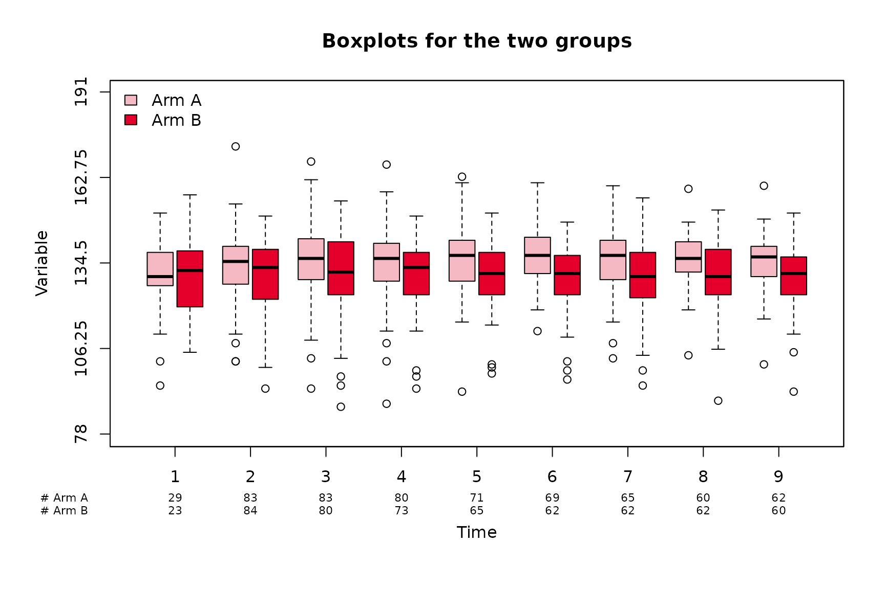

Now let us imagine that we want the order of the treatment groups to be
reversed.

``` r

hemoglobin$Arm <- factor(hemoglobin$Arm, levels = c("Arm B", 
                                                "Arm A"))

boxplotSCI(data = hemoglobin, 
                  var = hb, 
                  order = visit_nr, 
                  group = Arm, 
                  main = "Reversed treatment order", 
                  legend_position = "topright")
```

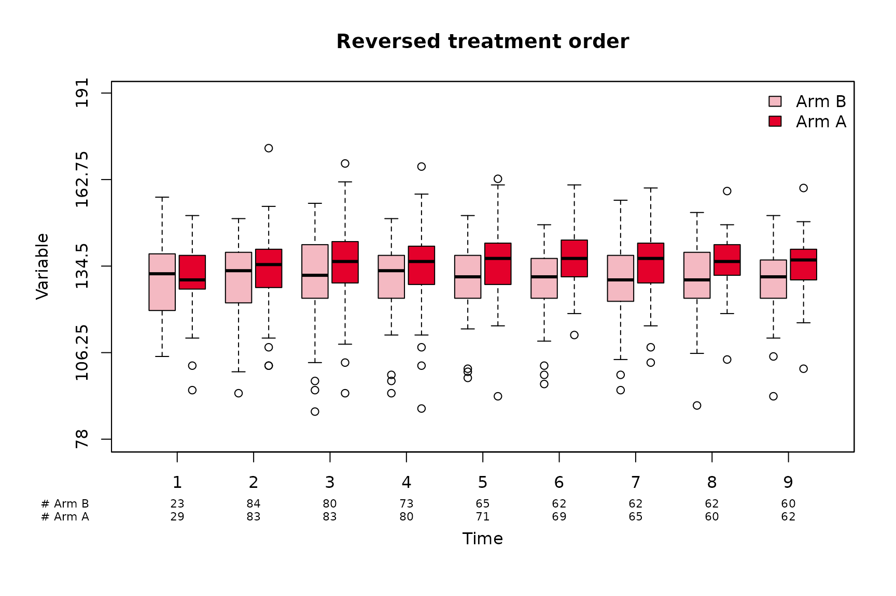

## Group names

The names of the two groups can be customized using `group_names` (for
the legend) and `group_names_short` for the x-axis. The order in
`group_names` and `group_names_short` must match the order of
`levels(factor(data$group))`

``` r

# back to original order
hemoglobin$Arm <- factor(hemoglobin$Arm, levels = c("Arm A", 
                                                "Arm B"))

boxplotSCI(data = hemoglobin, 
                  var = hb, 
                  order = visit_nr, 
                  group = Arm, 
                  group_names = c("Treatment (Arm A)", "Control (Arm B)"), 
                  group_names_short = c("A", "B"),
                  main = "Customization of group names", 
                  legend_position = "topright")
```

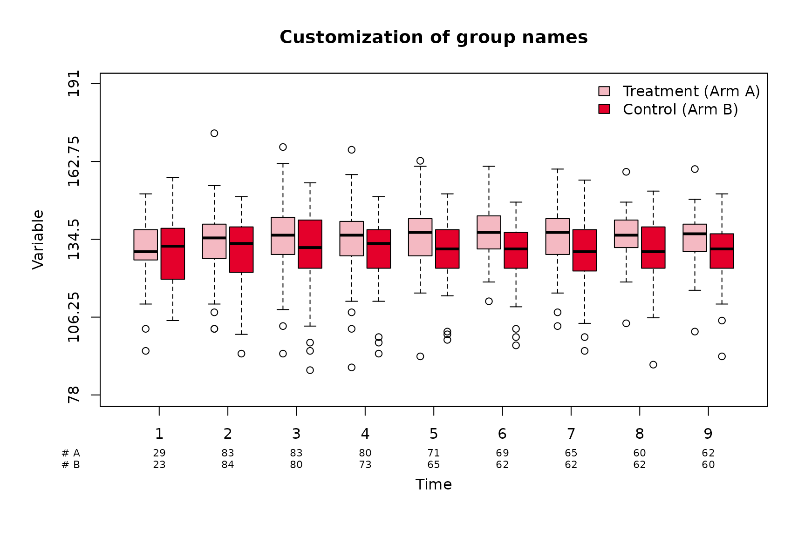

## One group

The function can also be used when there is only one group.

``` r

boxplotSCI(data = hemoglobin[hemoglobin$Arm == "Arm A", ], # Only treatment
                  var = hb, 
                  order = visit_nr,
                  main = "Only treatment group")
```

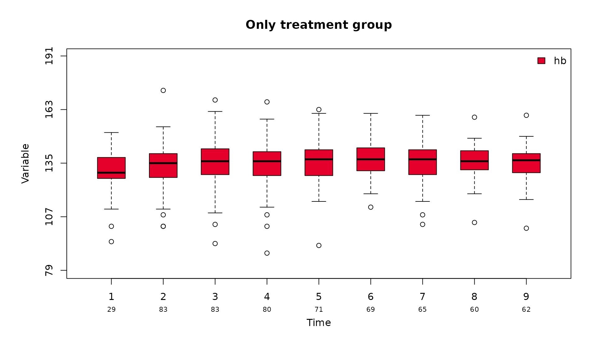

## Time points as factors

The function also accept time points given as factors. In this case, the
user needs to make sure that the factor is correctly ordered.

``` r

hemoglobin$visit <- factor(hemoglobin$visit,
                           levels = c("Cycle 1", "Cycle 2", "Cycle 3", 
                                      "Cycle 4", "Cycle 5", "Cycle 6", 
                                      "Cycle 7", "Cycle 8", "Cycle 9"))
```

``` r

boxplotSCI(data = hemoglobin, 
                  var = hb, 
                  order = visit, 
                  group = Arm, 
                  group_names = c("Treatment (Arm A)", "Control (Arm B)"), 
                  group_names_short = c("A", "B"),
                  main = "Time points as factor", 
                  legend_position = "topleft"
                  )
```

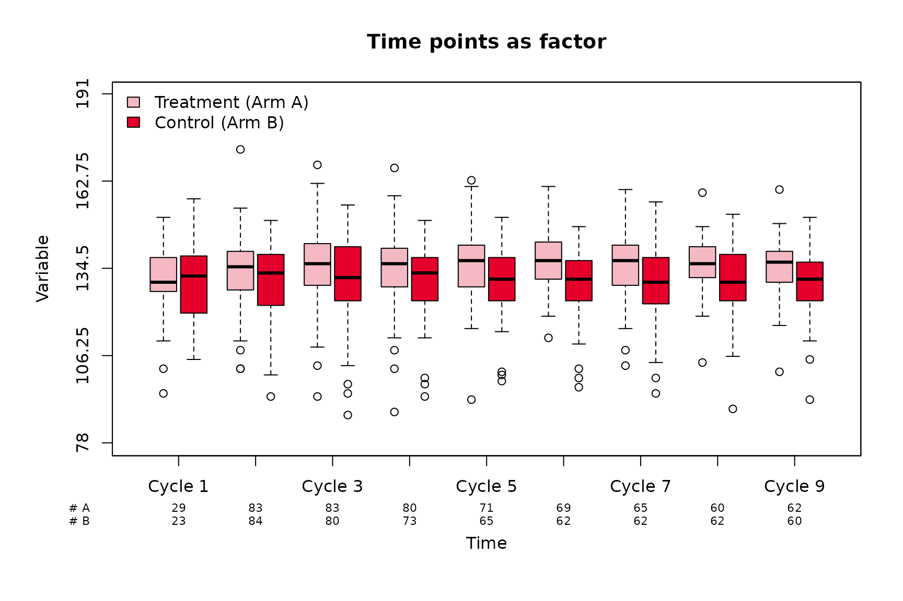

Another equivalent alternative is to put the numeric time points in
`order` and the labels in `visit`.

``` r


boxplotSCI(data = hemoglobin, 
                  var = hb, 
                  order = visit_nr, 
                  visit = visit,
                  group = Arm, 
                  group_names = c("Treatment (Arm A)", "Control (Arm B)"), 
                  group_names_short = c("A", "B"),
                  main = "Time points as factor", 
                  legend_position = "topleft"
                  )
```


## Customization of the boxplots

### Legend

The position and size of the legend can easily be adapted using the
arguments `legend_position` and `legend_cex`, respectively. A box can be
added around the legend using `legend_bty = "o"`.

``` r

boxplotSCI(data = hemoglobin, 
                  var = hb, 
                  order = visit_nr, 
                  group = Arm, 
                  # short names
                  group_names = c("Treatment (Arm A)", "Control (Arm B)"), 
                  group_names_short = c("A", "B"),
                  # Title
                  main = "Hemoglobin over time", 
                  # Legend position
                  legend_position = "bottomright",
                  # Legend size
                  legend_cex = 0.75, 
                  # Legend box
                  legend_bty = "o"
                  )
```

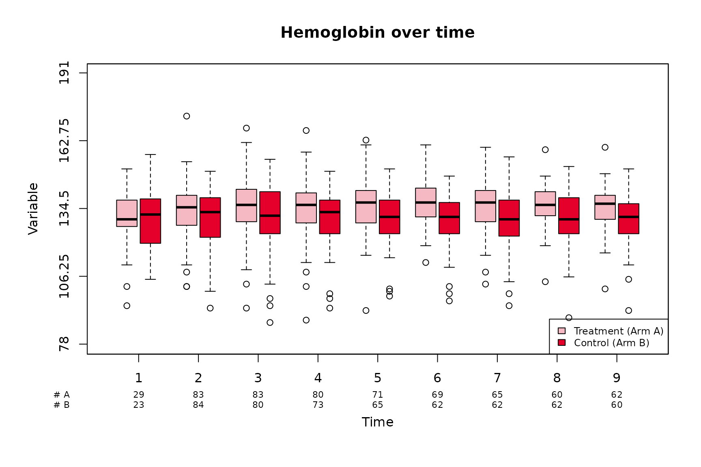

### Size and color of boxes

The color and size of the boxes can be customized using the arguments
`col` and `boxwex`. The distance between the boxes (when two groups are
compared) can be adjusted with the argument `shift`.

``` r


boxplotSCI(data = hemoglobin, 
                  var = hb, 
                  order = visit_nr, 
                  group = Arm, 
                  # short names
                  group_names = c("Treatment (Arm A)", "Control (Arm B)"), 
                  group_names_short = c("A", "B"),
                  # Title
                  main = "Hemoglobin over time", 
                  # Col of boxes
                  col = c("lightblue", "orange"),
                  # Width of boxes
                  boxwex = 0.2, 
                  #Space between boxes
                  shift = 0.15,
                  # Legend position
                  legend_position = "topleft",
                  )
```

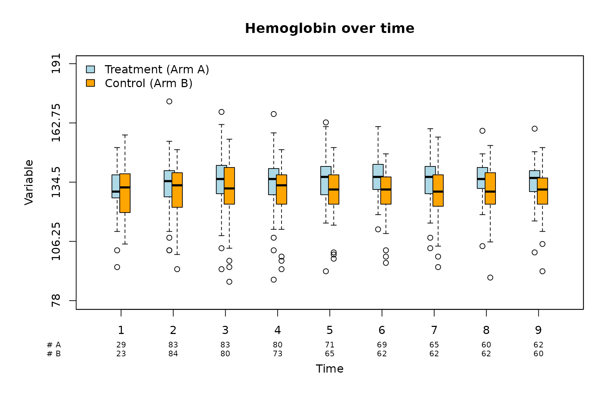

### Axes

Various parameters related to the axes can be customized using `xlab`,
`ylab`, `cex_lab`, `cex_axis`, `ylim` and `y_ticks`.

``` r

par(las = 1)
boxplotSCI(data = hemoglobin, 
                  var = hb, 
                  order = visit_nr, 
                  group = Arm, 
                  group_names = c("Treatment (Arm A)", "Control (Arm B)"), 
                  group_names_short = c("A", "B"),
                  # Title
                  main = "Hemoglobin over time", 
                  # X axis label
                  xlab = "Visits", 
                  # X axis position
                  xlab_position = 0,
                  # Y axis label
                  ylab = "Score",
                  # Size of axis labels
                  cex_lab = 1.2,
                  # Size of axes
                  cex_axis = 1.1,
                  # Size of number of patients
                  cex_n_patients = 0.9,
                  # Y axis limit
                  ylim = c(80, 200),
                  # Y axis ticks
                  y_ticks = seq(80, 180, by = 10),
                  legend_position = "topleft"
                  )
```

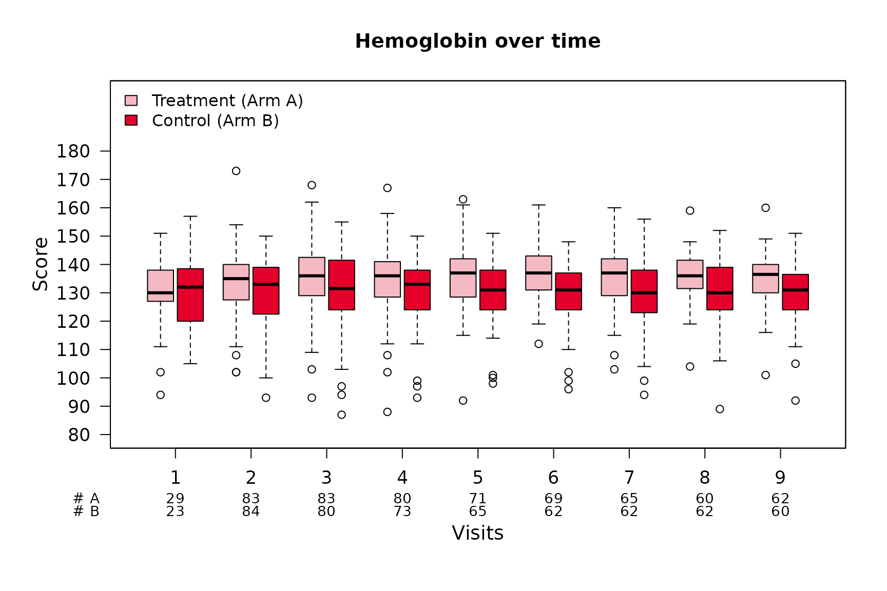

### Lines and colors

Lines can be added using `lines` and their color and type specified
using `col_lines` and `lty`, respectively.

``` r


boxplotSCI(data = hemoglobin, 
                  var = hb, 
                  order = visit_nr, 
                  group = Arm, 
                  group_names = c("Treatment (Arm A)", "Control (Arm B)"), 
                  group_names_short = c("A", "B"),
                  # Title
                  main = "Hemoglobin over time", 
                  # Col of boxes
                  col = c("lightblue", "orange"),
                  # X axis label
                  xlab = "Visits", 
                  # X axis position
                  xlab_position = 0,
                  # Y axis label
                  ylab = "Score",
                  lines = c(90, 120, 160), 
                  # Col of lines
                  col_lines = c("red", "grey", "red"), 
                  # Type of lines
                  lty = c(2, 3, 2)
                  )
```

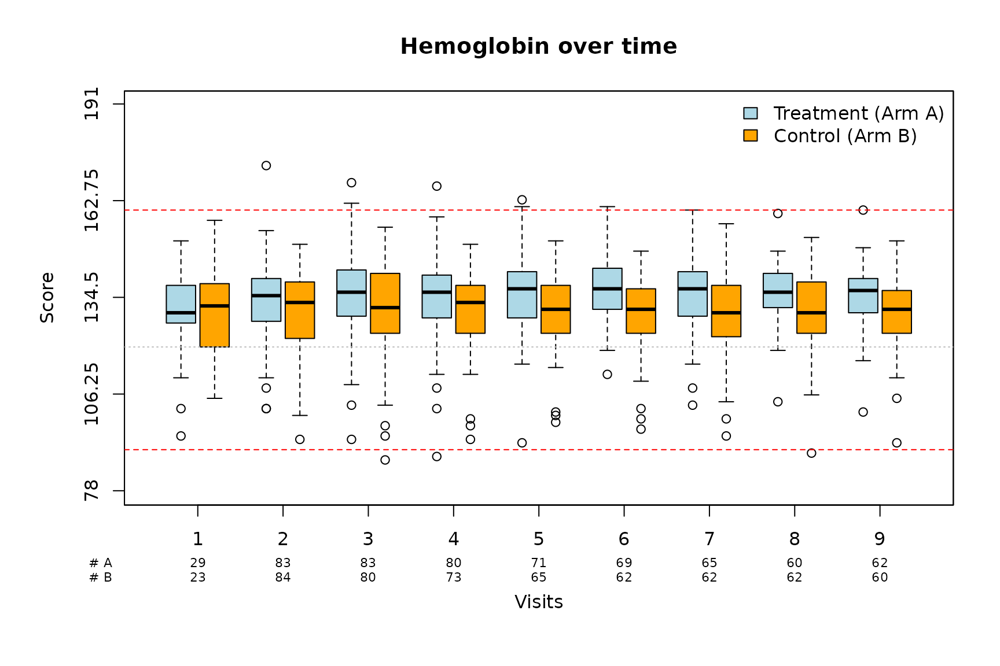

## Special case: only one time point

The function also works if no intput is provided for `order` or if
`order` only contains one time point.

``` r

par(las = 1)
boxplotSCI(data = hemoglobin[hemoglobin$visit_nr == 4, ], 
                  var = hb, 
                  # order = visit_nr, 
                  group = Arm, 
                  main = "Only one time point"
                  )
```

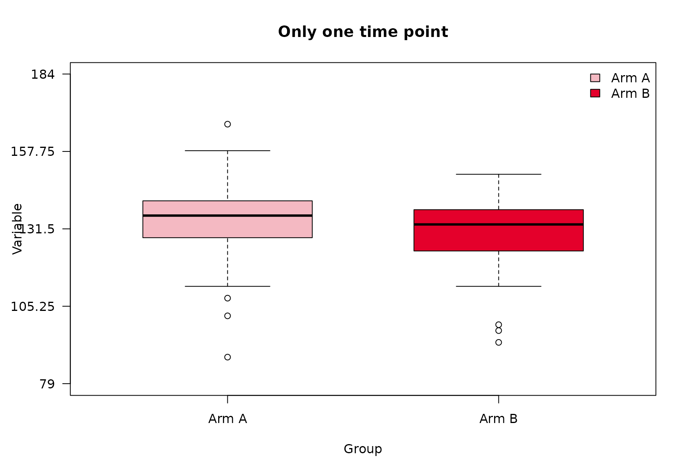

## Time point is missing for one group

The function also works if one (or more) time points are missing for one
of the groups. The argument `missing_nr` controls what should be
displayed for the number of patients for the missing time point. Default
to `0`. For example, let us assume that there is no hemoglobin value for
the patient in the `Arm A` group at time point `8`:

``` r

 
hemoglobin_2 <- hemoglobin[!(hemoglobin$Arm == "Arm A" & hemoglobin$visit_nr == 8), ]


# numeric
boxplotSCI(data = hemoglobin_2,
                var = hb,
                order = visit_nr,
                group_names = c("Treatment (Arm A)", "Control (Arm B)"), 
                group_names_short = c("A", "B"),
                group = Arm,
                main = "Boxplots for the two groups", 
                legend_position = "topleft", 
                missing_nr = 0)
```

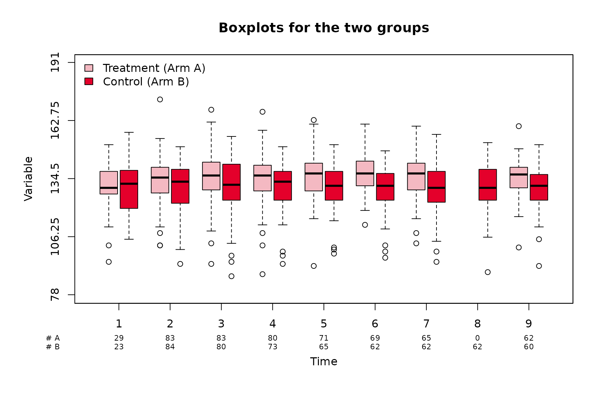

Now let us imagine that there is no hemoglobin value for the patients in
the `Arm B` group after timepoint 4:

``` r


hemoglobin_3 <- hemoglobin[!(hemoglobin$Arm == "Arm B" & hemoglobin$visit_nr > 4), ]


# numeric
boxplotSCI(data = hemoglobin_3,
                var = hb,
                order = visit_nr,
                group_names = c("Treatment (Arm A)", "Control (Arm B)"), 
                group_names_short = c("A", "B"),
                group = Arm,
                main = "Boxplots for the two groups", 
                legend_position = "topleft", 
                missing_nr = NA)
```

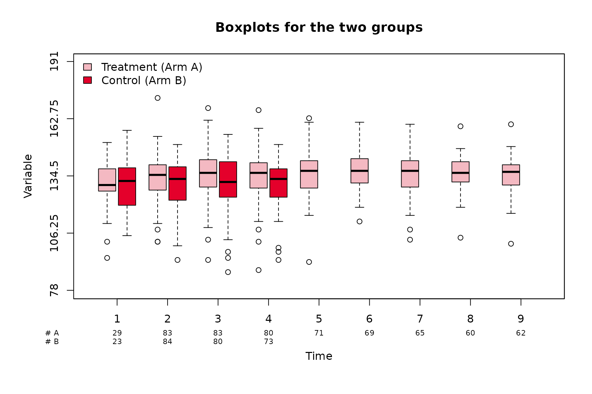
