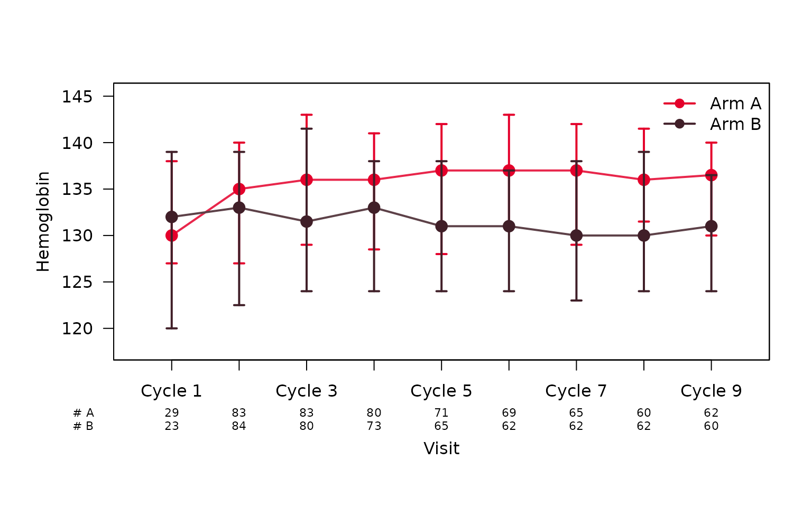
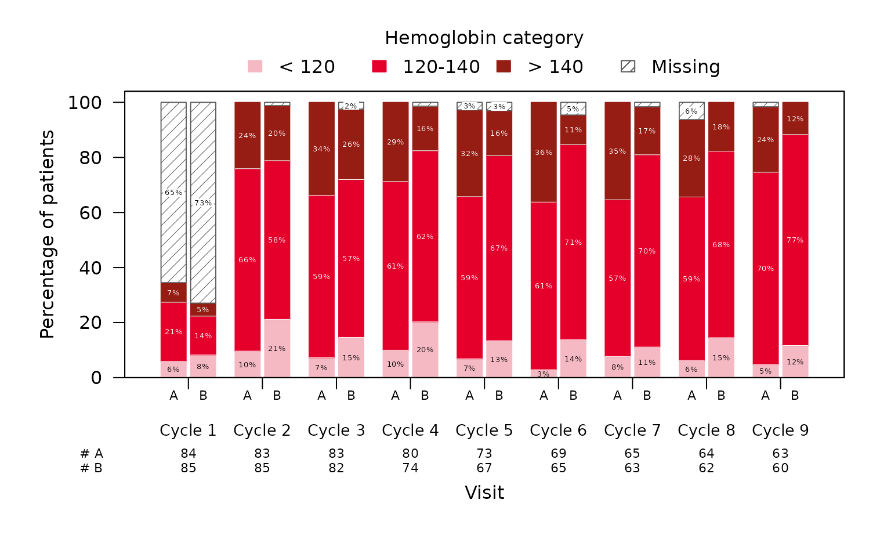
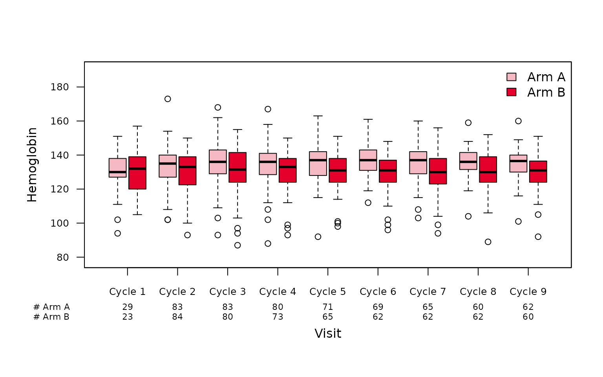

# summarizeByVisitSCI

[`summarizeByVisitSCI()`](https://sakk-statistics.github.io/summarySCI/reference/summarizeByVisitSCI.md)
is the counterpart of
[`summarizeSCI()`](https://sakk-statistics.github.io/summarySCI/reference/summarizeSCI.md)
for data collected over several visits. It produces the table of
[`summaryByVisit()`](https://sakk-statistics.github.io/summarySCI/reference/summaryByVisit.md)
and one plot per variable over the visits: a line plot (or boxplots) for
continuous variables and stacked barplots for categorical ones.

## Setup and data

``` r

library(summarySCI)
data(hemoglobin_data)

hb <- hemoglobin_data
hb$hb_cat <- cut(hb$hb, c(-Inf, 120, 140, Inf),
                 labels = c("< 120", "120-140", "> 140"))
```

## Table and plots

The arguments are those of
[`summaryByVisit()`](https://sakk-statistics.github.io/summarySCI/reference/summaryByVisit.md).
The visits appear in the order of the table; with `order`, its values
also set the spacing of the visits in the line plot.

``` r

res <- summarizeByVisitSCI(hb, vars = c("hb", "hb_cat"), group = "Arm",
                           visit = "visit", order = "visit_nr",
                           stat_cont = "median_IQR",
                           labels = list(hb_cat = "Hemoglobin category"),
                           plot_args = list(risk_table = TRUE,
                                            group_names_short = c("A", "B")))
res$table
```

[TABLE]

``` r

res$plots$hb
```



``` r

res$plots$hb_cat
```



As in
[`summarizeSCI()`](https://sakk-statistics.github.io/summarySCI/reference/summarizeSCI.md),
`type = "table"` or `"plot"` returns only one of them, the table’s
settings (labels, `missing`, `missing_percent`, `stat_cat`) carry over
to the plots, and further plot options go into `plot_args` (see
[`?lineplotSCI`](https://sakk-statistics.github.io/summarySCI/reference/lineplotSCI.md),
[`?boxplotSCI`](https://sakk-statistics.github.io/summarySCI/reference/boxplotSCI.md)
and
[`?stackedbarplotSCI`](https://sakk-statistics.github.io/summarySCI/reference/stackedbarplotSCI.md)).

## The plots show the numbers of the table

The line plots and stacked bars are drawn from the numbers printed in
the table, as
[`plotByVisit()`](https://sakk-statistics.github.io/summarySCI/reference/plotByVisit.md)
does: they show exactly what the table shows, with its rounding, its
visits and its N columns as the risk table. `stat_cont` decides what the
line plot shows:

| `stat_cont`      | Point          | Error bars                 |
|------------------|----------------|----------------------------|
| `"median_range"` | median         | minimum to maximum         |
| `"median_IQR"`   | median         | first to third quartile    |
| `"mean_sd"`      | mean           | +/- one standard deviation |
| `"mean_se"`      | mean           | +/- one standard error     |
| `"geomMean_sd"`  | geometric mean | ÷ and × geometric SD       |

The geometric mean needs positive values: the table shows `NA` for
visits with values of zero or below, and the line plot leaves those
points out. `plot_args = list(stat_footnote = TRUE)` names the statistic
in a footnote under each plot.

`plot_cont = "boxplot"` draws boxplots per visit instead of the line
plot. A boxplot shows more than the table holds, so it is drawn from the
data: from the rows the table summarizes, with the box at the quartiles
as the table computes them. It always shows the median and quartiles,
whatever `stat_cont` the table uses; with `"median_IQR"` the two agree.

``` r

res_box <- summarizeByVisitSCI(hb, vars = "hb", group = "Arm",
                               visit = "visit", order = "visit_nr",
                               stat_cont = "mean_sd", plot_cont = "boxplot",
                               plot_args = list(cex_axis = 0.8))
res_box$plots$hb
```



## Saving the table and plots

`word_output = TRUE` (with `file_path`) and
[`save_plots()`](https://sakk-statistics.github.io/summarySCI/reference/save_plots.md)
work as described in
[`vignette("summarizeSCI")`](https://sakk-statistics.github.io/summarySCI/articles/summarizeSCI.md):

``` r

basename(save_plots(res, file_name = "visit", file_path = tempdir(),
                    width = 9, height = 5.5))
#> [1] "visit_hb.png"     "visit_hb_cat.png"
```
