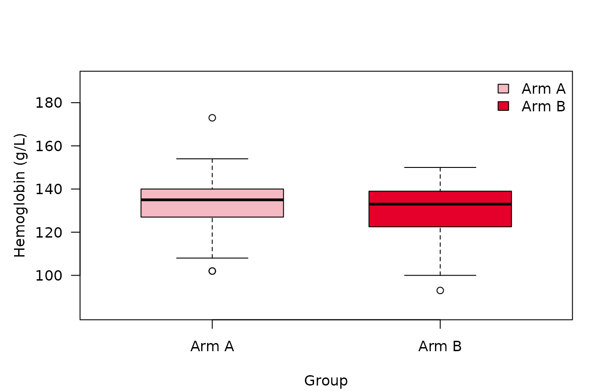
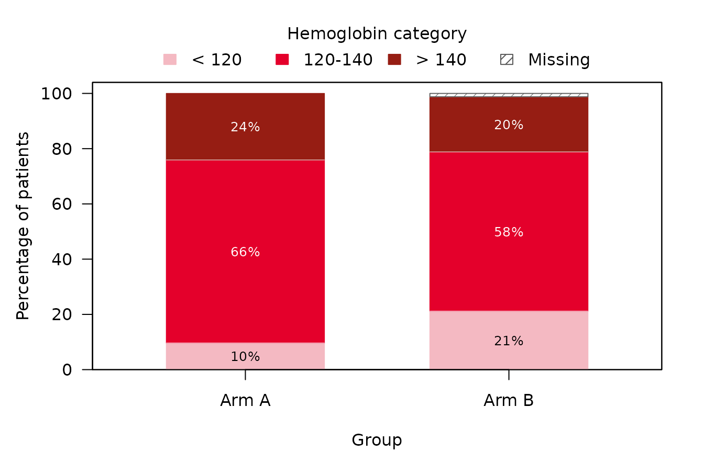
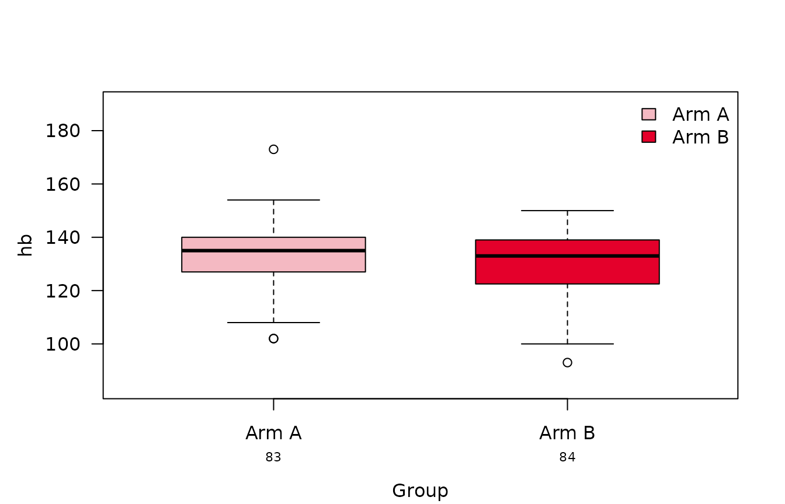
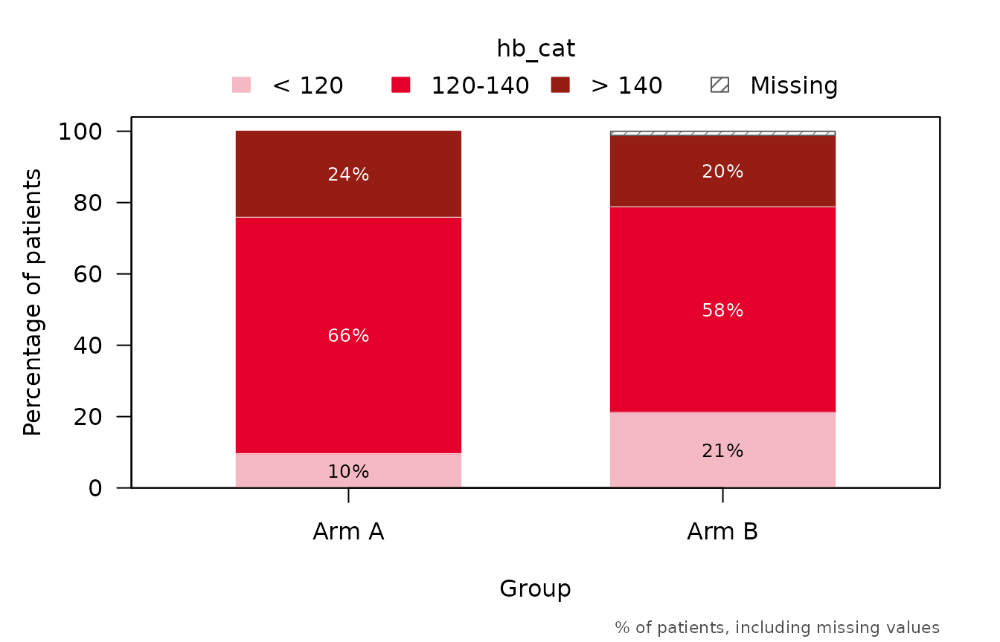

# summarizeSCI

[`summarizeSCI()`](https://sakk-statistics.github.io/summarySCI/reference/summarizeSCI.md)
produces, in one call, the summary table of
[`summaryTable()`](https://sakk-statistics.github.io/summarySCI/reference/summaryTable.md)
and one plot per variable: a boxplot for continuous variables and a
stacked barplot for categorical and dichotomous ones. The type of each
plot follows the type the variable has in the table, so table and plots
always agree. The plots use the same rows as the table, and the box of
the boxplot spans the quartiles as the table computes them, so it shows
the numbers of a `"median_IQR"` table.

## Setup and data

We use the hemoglobin values of the second visit of
[`summarySCI::hemoglobin_data`](https://sakk-statistics.github.io/summarySCI/reference/hemoglobin_data.md),
and add a categorical version of them.

``` r

library(summarySCI)
data(hemoglobin_data)

hb2 <- hemoglobin_data[hemoglobin_data$visit_nr == 2, ]
hb2$hb_cat <- cut(hb2$hb, c(-Inf, 120, 140, Inf),
                  labels = c("< 120", "120-140", "> 140"))
```

## Table and plots

By default (`type = "both"`), the result holds the table and the plots,
which are addressed by variable name.

``` r

res <- summarizeSCI(hb2, vars = c("hb", "hb_cat"), group = "Arm",
                    labels = list(hb = "Hemoglobin (g/L)",
                                  hb_cat = "Hemoglobin category"))
names(res$plots)
#> [1] "hb"     "hb_cat"
res$table
```

[TABLE]

``` r

res$plots$hb
```



``` r

res$plots$hb_cat
```



Use `type = "table"` or `type = "plot"` to get only one of them.

``` r

plots <- summarizeSCI(hb2, vars = c("hb", "hb_cat"), group = "Arm",
                      type = "plot")$plots
```

## Settings carry over to the plots

The settings of the table are applied to the plots as well:

- the variable labels become the axis and legend titles;
- missing values form a segment of their own exactly when the table’s
  percentages count them (`missing`, `missing_percent`);
- `stat_cat = "n"` shows counts instead of percentages.

``` r

res_n <- summarizeSCI(hb2, vars = "hb_cat", group = "Arm",
                      stat_cat = "n", missing_percent = FALSE)
res_n$plots$hb_cat
```


## Plot options

Options that only concern the plots go into `plot_args`. Each plot takes
the arguments its plotting function has (see
[`?boxplotSCI`](https://sakk-statistics.github.io/summarySCI/reference/boxplotSCI.md)
and
[`?stackedbarplotSCI`](https://sakk-statistics.github.io/summarySCI/reference/stackedbarplotSCI.md));
an argument that no plot uses gives a warning.

``` r

res_opt <- summarizeSCI(hb2, vars = c("hb", "hb_cat"), group = "Arm",
                        type = "plot",
                        plot_args = list(risk_table = TRUE,
                                         group_names_short = c("A", "B")))
res_opt$plots$hb
```



`stat_footnote = TRUE` adds a footnote in the bottom-right corner saying
what a plot shows, e.g. the box and whiskers of a boxplot or the
denominator of the percentages of a stacked bar; a character string
gives a text of your own.

``` r

res_note <- summarizeSCI(hb2, vars = "hb_cat", group = "Arm", type = "plot",
                         plot_args = list(stat_footnote = TRUE))
res_note$plots$hb_cat
```



## Saving the table and plots

With `word_output = TRUE`, the table is also saved to a Word document at
`file_path`, exactly as
[`summaryTable()`](https://sakk-statistics.github.io/summarySCI/reference/summaryTable.md)
saves it:

``` r

summarizeSCI(hb2, vars = c("hb", "hb_cat"), group = "Arm",
             word_output = TRUE, file_path = "hemoglobin_table.docx")
```

[`save_plots()`](https://sakk-statistics.github.io/summarySCI/reference/save_plots.md)
writes every plot of a result into its own file. The format (`"png"`,
`"jpeg"`, `"tiff"`, `"pdf"` or `"svg"`), size in inches and resolution
are set with `format`, `width`, `height` and `res`. Since each plot is
redrawn at the requested size, its layout always fits the file.

``` r

out <- file.path(tempdir(), "figures")

# one file per variable, named after it
basename(save_plots(res, file_path = out))
#> [1] "hb.png"     "hb_cat.png"

# a single name prefixes the variable names
basename(save_plots(res, file_name = "fig", file_path = out, format = "pdf"))
#> [1] "fig_hb.pdf"     "fig_hb_cat.pdf"

# one name per plot, or a single plot
basename(save_plots(res, file_name = c("hb_box", "hb_bars"), file_path = out))
#> [1] "hb_box.png"  "hb_bars.png"
basename(save_plots(res$plots$hb, file_name = "hemoglobin", file_path = out,
                    width = 6, height = 4))
#> [1] "hemoglobin.png"
```
